

  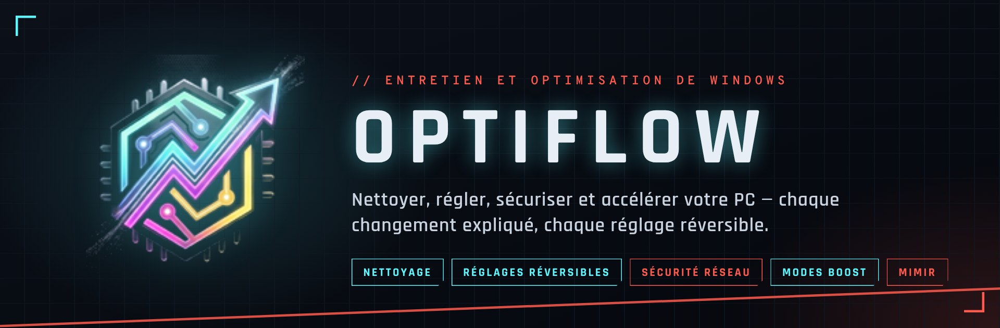

  
  
  
  

<h3 align="center">
  <a href="https://github.com/souma974/optiflow-releases/releases/latest">⬇ Télécharger OptiFlow pour Windows</a>
</h3>

---

## // Qu'est-ce qu'OptiFlow ?

OptiFlow réunit en une seule application tout l'entretien d'un PC Windows : nettoyage, réglages de confidentialité et de performance, logiciels et pilotes, sécurité du réseau domestique, modes Boost, éclairage des manettes… et un assistant, **Mimir**, qui trouve le bon réglage quand on lui explique ce qu'on veut.

Trois principes guident chaque écran :

- **Expliquer avant d'agir.** Chaque réglage dit ce qu'il change, pourquoi, et ce qu'il peut couper.
- **Tout est réversible.** Chaque réglage garde la valeur d'origine de Windows et son bouton « Rétablir » ; ce qui ne se recrée pas passe par la corbeille ; l'historique garde la trace de tout.
- **Rien ne sort de votre PC.** Aucune télémétrie, aucun compte à créer. Internet n'est utilisé que pour ce que vous demandez (installer un logiciel, chercher des mises à jour).

## // Aperçu

> Captures de l'interface réelle, avec des données de démonstration. Thème « Cyber », l'un des quatorze thèmes proposés.

  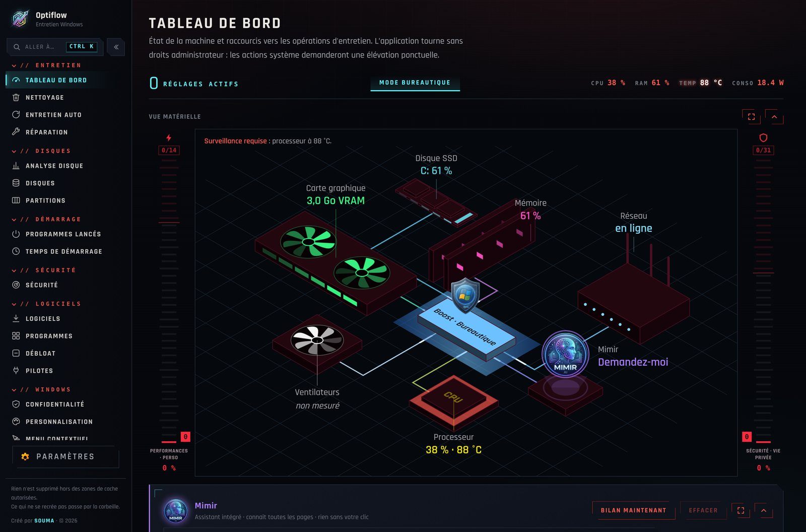
   <b>Tableau de bord</b> — la vue matérielle en direct (processeur, carte graphique, mémoire, disques, réseau), les modes Boost et Mimir.

<table>
  <tr>
    <td width="50%">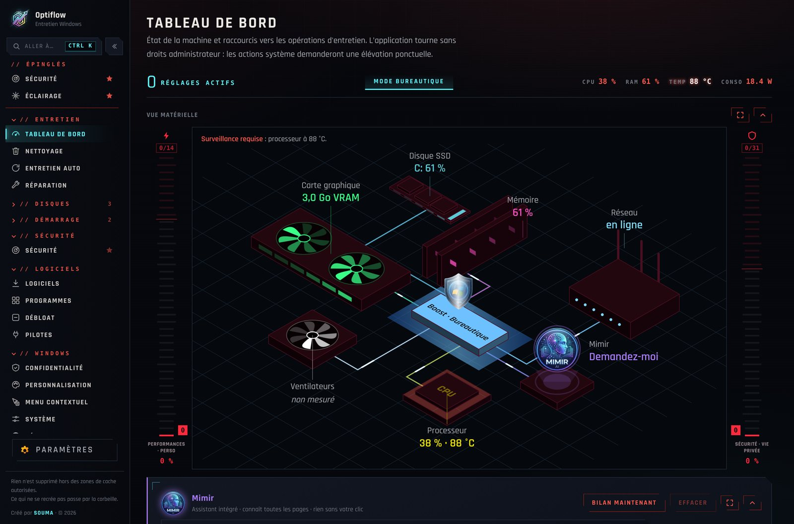 <b>Menu pratique</b> — pages épinglées en tête, sections repliables, menu réduit aux icônes (Ctrl+B).</td>
    <td width="50%">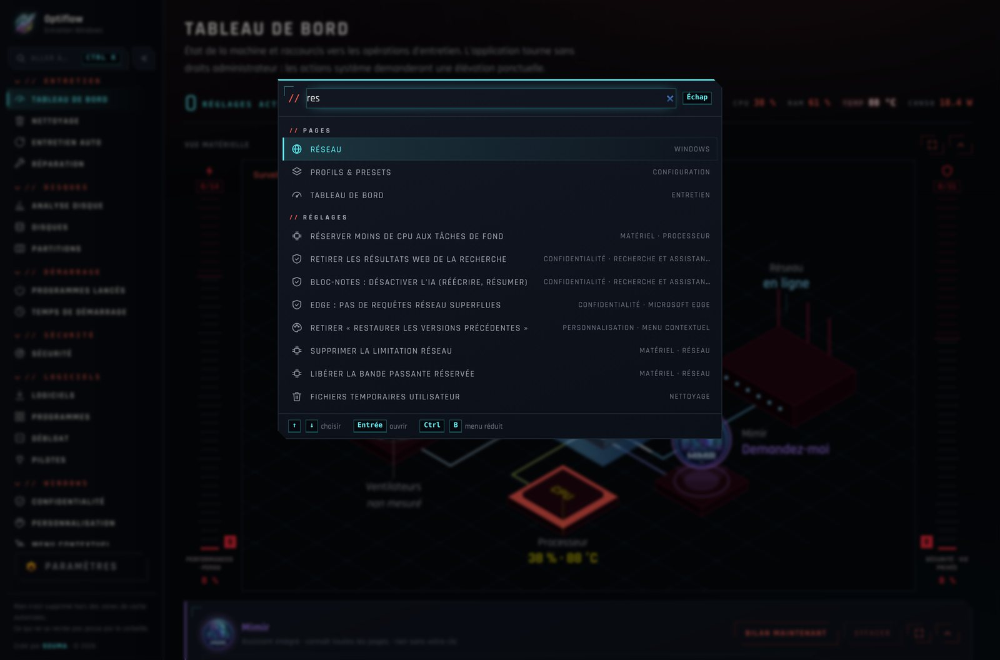 <b>Palette « Aller à… » (Ctrl+K)</b> — n'importe quelle page ou réglage en trois touches, sans accents ni majuscules à respecter.</td>
  </tr>
  <tr>
    <td>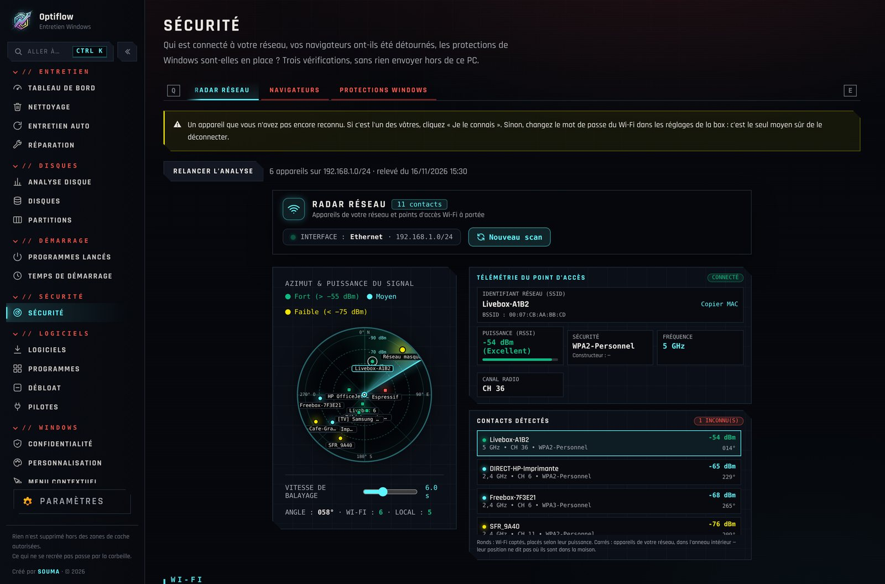 <b>Sécurité · Radar</b> — les appareils de votre réseau et les Wi-Fi alentour, l'appareil inconnu repéré.</td>
    <td>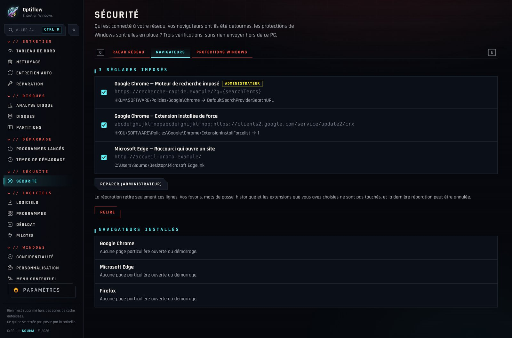 <b>Sécurité · Navigateurs</b> — page d'accueil, moteur de recherche ou extensions imposés par un logiciel indésirable, retirés en un clic.</td>
  </tr>
  <tr>
    <td>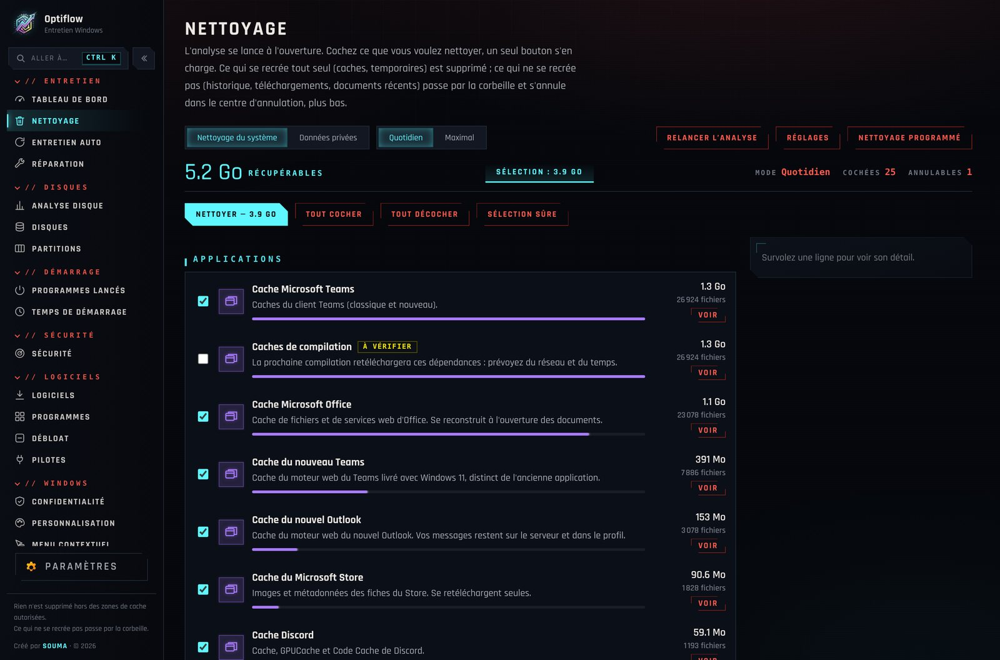 <b>Nettoyage</b> — caches et fichiers temporaires, avec simulation avant de supprimer quoi que ce soit.</td>
    <td>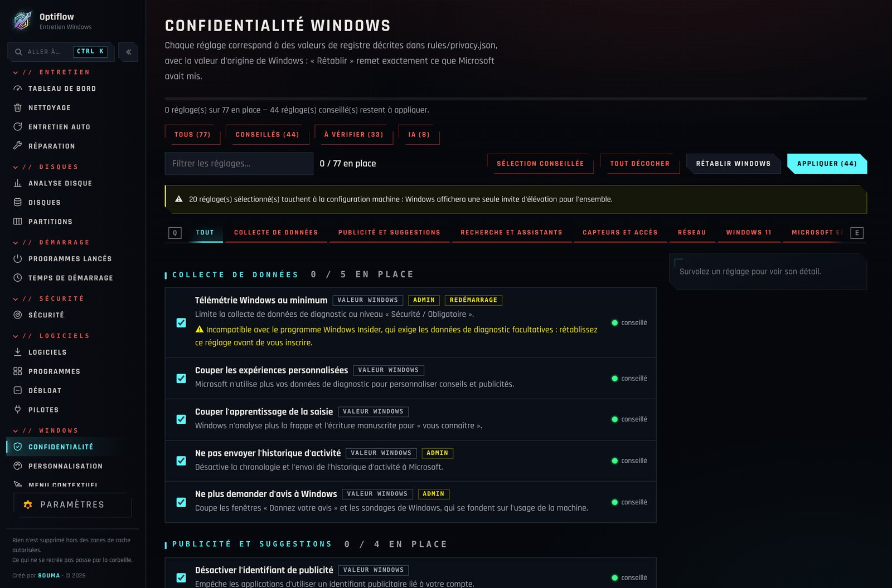 <b>Confidentialité</b> — télémétrie, publicités, Copilot, Recall, IA de Paint et de Chrome : chaque réglage décrit et réversible.</td>
  </tr>
  <tr>
    <td>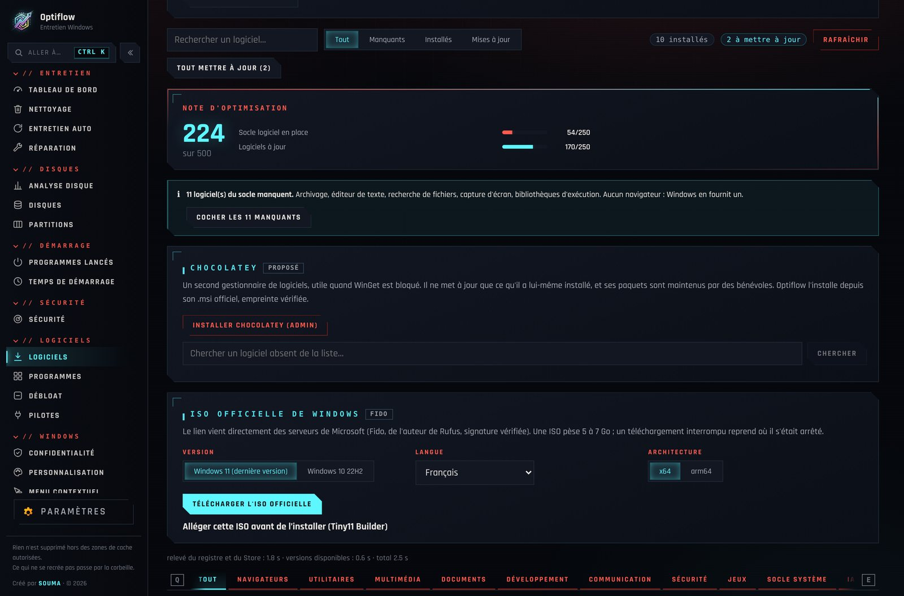 <b>Logiciels</b> — un catalogue par catégorie, installations vérifiées et mises à jour en masse.</td>
    <td>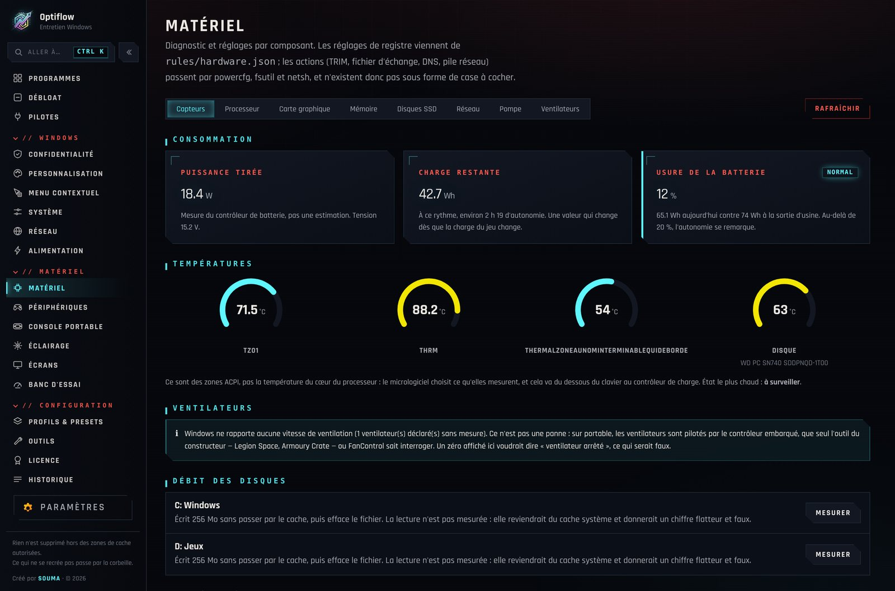 <b>Matériel</b> — consommation, températures, ventilateurs, débit des disques.</td>
  </tr>
</table>

## // Fonctions

| Famille | Ce qu'on y trouve |
|---|---|
| **Entretien** | Tableau de bord et bilan avant / après · Nettoyage avec simulation · Entretien automatique hebdomadaire · Réparation de Windows (DISM, SFC, chkdsk, remise à zéro de Windows Update) |
| **Disques** | Analyse de l'espace, gros fichiers et doublons · Usure réelle des SSD, TRIM ou défragmentation · Partitions (renommer, redimensionner, créer) |
| **Démarrage** | Programmes lancés à l'ouverture de session, désactivés sans rien supprimer · Ce que chaque programme, pilote ou service coûte au démarrage |
| **Sécurité** | Radar du réseau domestique · Réparation des navigateurs détournés · État de l'antivirus, du pare-feu et des protections de Windows |
| **Logiciels** | Catalogue et mises à jour (WinGet, sources officielles, Chocolatey au choix) · Désinstallation · Retrait des applications préinstallées · Pilotes |
| **Windows** | Confidentialité · Personnalisation (barre des tâches, Explorateur, menu Démarrer) · Menu contextuel · Système (UAC, Windows Update, jeux) · Réseau et DNS · Alimentation |
| **Matériel** | Processeur, carte graphique, mémoire, SSD, réseau · Périphériques (manettes, souris, clavier, curseurs) · Consoles portables · Éclairage des manettes · Écrans et HDR automatique · Banc d'essai |
| **Configuration** | Presets Minimal, Équilibré ou Agressif · Profils exportables · Historique de tout ce qui a été fait |

### Modes Boost et bilan
Un mode par usage — **Bureautique** ou **Gamer** — qui allège Windows sans toucher à sa protection. Le **bilan avant / après** mesure ce qui a vraiment changé (mémoire, processus, démarrage, espace libre, température) et ne confond pas le bruit avec un gain.

### Éclairage des manettes
Profils de couleur, d'effet et de vitesse qui se déclenchent seuls : au lancement d'un jeu, sur batterie, avec un mode Boost. Pris en charge : DualSense, DualShock 4, Switch Pro, manettes Xbox (USB), 8BitDo Ultimate 2 Wireless, Legion Go et Legion Go 2, ROG Ally, MSI Claw.

### Mimir, l'assistant
« Mon PC rame », « désactive Copilot », « qui est connecté à mon wifi ? » : Mimir comprend la demande, propose l'action et ne fait rien sans votre clic. Il répond sur votre machine.

## // Installation

1. Téléchargez `Optiflow.Setup.x.y.z.exe` depuis la **[dernière version](https://github.com/souma974/optiflow-releases/releases/latest)**.
2. Lancez-le. L'installation se fait pour votre compte, sans droits administrateur ; OptiFlow les demandera seulement pour les actions qui l'exigent.

  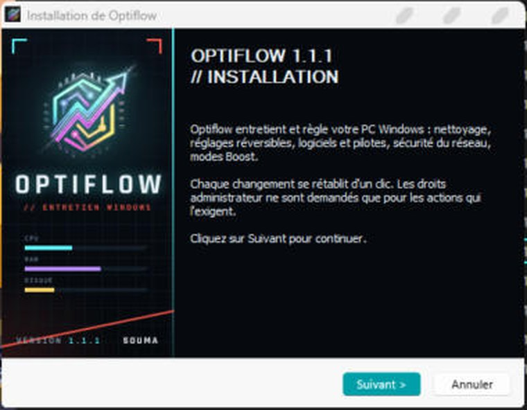

> **« Éditeur inconnu » ?** L'installateur n'est pas encore signé par un certificat d'éditeur : Windows SmartScreen peut afficher un avertissement. Cliquez sur « Informations complémentaires » puis « Exécuter quand même ».
>
> **Vérifier le fichier :** chaque version indique l'empreinte SHA-256 de son installateur dans ses notes. Dans PowerShell : `Get-FileHash .\Optiflow.Setup.x.y.z.exe`

**Configuration requise** : Windows 10 ou 11, 64 bits (x64) · environ 170 Mo à télécharger · un compte administrateur pour les réglages système.

## // Questions fréquentes

<b>OptiFlow peut-il abîmer mon installation de Windows ?</b>

Chaque réglage est décrit avant d'être appliqué et garde son retour en arrière ; les réglages sensibles portent un avertissement et demandent une confirmation. Un point de restauration peut être créé avant un lot de changements.

<b>D'où viennent les logiciels installés ?</b>

Des sources officielles : le catalogue WinGet, les publications GitHub des éditeurs, ou Chocolatey si vous choisissez de l'installer. Les empreintes sont vérifiées avant toute installation.

<b>Fonctionne-t-il sur une console portable ?</b>

Oui : Legion Go et Legion Go 2, ROG Ally et MSI Claw ont une page dédiée (puissance, éclairage, outils du constructeur). Le menu réduit aux icônes laisse toute la place au contenu sur les petits écrans.

<b>Est-ce gratuit ?</b>

Oui. Des offres Pro et Famille sont prévues pour ce qui travaille à votre place (surveillance continue, automatismes, réparations en un clic) ; tout ce qui se fait à la main restera gratuit.

## // Confidentialité

OptiFlow n'envoie aucune télémétrie. Réglages, historique, mesures du bilan et relevés du radar restent dans le dossier de données de l'application, sur votre PC. Les connexions à Internet n'ont lieu qu'à votre demande : catalogues de logiciels, Windows Update, téléchargement d'images Windows.

## // Contact

Questions, suggestions, problème : **djax97600@gmail.com**

Ce dépôt ne contient que les fichiers d'installation et cette présentation ; le code source n'est pas public.

© 2026 SOUMA · OptiFlow n'est affilié à aucune des marques citées (Windows, Xbox, DualSense, Legion, ROG, Claw, 8BitDo…), qui appartiennent à leurs propriétaires respectifs.

